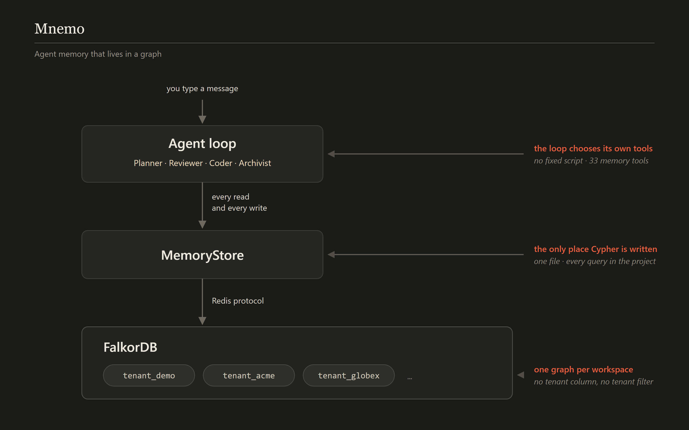
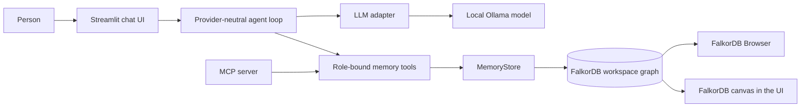

# Mnemo

**Agents whose memory is a FalkorDB graph.**

Mnemo is a local-first, multi-agent memory system built for the GraphHacks
hackathon by WeMakeDevs and FalkorDB. Conversations, facts, decisions, standing
rules, agent tasks, and the reads behind answers are stored in FalkorDB and
retrieved from the graph when needed. Agents coordinate by reading and writing
that shared graph, not by passing private summaries to each other.

**Tracks:** Track 02 — Agent Memory and Coordination (primary); Track 01 —
Agents That Act on Connected Data (action layer)

**Demo:** [Watch Mnemo](https://www.youtube.com/watch?v=oFKfePtkjCI)

**Source:** [Dhairya-Senpai/mnemo](https://github.com/Dhairya-Senpai/mnemo)

## What Mnemo demonstrates

- **Episodic memory:** conversations and agent actions persist as events in the
  graph and can be read back across sessions.
- **Semantic memory:** decisions, facts, and insights are structured as graph
  nodes and relationships, not only as text in a transcript.
- **Procedural memory:** an agent can learn a standing rule, then retrieve and
  apply it in a later session.
- **Memory that changes:** facts and decisions can be retired or superseded.
  Their previous versions and provenance remain queryable.
- **Coordination through shared state:** the Planner can leave a graph task
  that another agent claims and works on without receiving the Planner's
  conversational context.
- **Graph-based action and explanation:** an agent can follow dependencies,
  identify a blocker, file a ticket that cites the decision behind it, and
  expose the reads that informed an answer.
- **Tenant separation:** each workspace is a distinct FalkorDB graph.

## Demo video

[Watch the working project on YouTube](https://www.youtube.com/watch?v=oFKfePtkjCI).

The demo shows persistent memory across sessions, changes to remembered facts,
agents handing off work through the graph, and graph-backed explanations.

## FalkorDB in Mnemo

FalkorDB is Mnemo's **memory store, coordination substrate, query engine, and
graph-algorithm runtime**. It is not an optional cache: without FalkorDB there
is no conversation history, remembered state, task queue, tenant boundary, or
reasoning trace.

The project uses:

- **FalkorDB Graph Database** to store a property graph for each workspace.
  The Python `MemoryStore` issues parameterized Cypher reads and writes
  directly against those graphs.
- **FalkorDB's Cypher implementation** for current-fact filtering, provenance
  traversal, multi-hop dependency queries, topic-based conversation recall,
  task claiming, and full-text search over recorded conversations.
- **FalkorDB's `algo.betweenness` procedure** for the Track 01 dependency
  centrality demonstration.
- **FalkorDB Browser** on port `3000` for inspecting and querying the running
  database during development and demos.
- **FalkorDB's `@falkordb/canvas` component** to render the graph in Mnemo's
  UI. The app marks retired edges and highlights nodes cited by the most
  recent answer. The component is loaded from a pinned jsDelivr URL, so this
  graph visualization requires network access if the component is not already
  cached.

The app and model run locally with Docker Compose; there is no public hosted
deployment. Initial Docker image and model downloads require network access.
After those assets are present locally, the database and Ollama model run on
the machine. The graph canvas is the exception when its CDN asset is not
cached.

## Graph memory flow

The diagram below shows the core agent-to-memory path and how separate
workspace graphs provide tenant isolation. It focuses on runtime memory access;
the fuller application architecture, including the UI, Ollama adapter, and MCP
transport, is shown after it.



*The diagram's “only place Cypher is written” note refers to runtime memory
queries. The seed scripts also issue Cypher to construct the demo graphs.*

## Full application architecture



The agent loop owns the tool-call cycle; the model adapter translates messages
and tool schemas to and from the provider API. The current real provider is
Ollama. Agents do not call FalkorDB directly: their role-specific tools dispatch
through `MemoryStore`, where query construction, validation, and graph writes
are centralized. The optional MCP server exposes the same tools through the
Model Context Protocol.

Useful implementation references:

- [Agent loop](src/agents/loop.py)
- [Agent roles and handoff](src/agents/team.py)
- [Tool catalogue and dispatch](src/agents/toolbox.py)
- [Graph-backed memory store](src/memory/store.py)
- [LLM adapter interface](src/llm/base.py)
- [MCP server](scripts/mcp_server.py)

## Graph data model

The schema separates memory by what it means and how it can change.

| Tier | Main nodes | Purpose and update behaviour |
|---|---|---|
| Episodic | `Session`, `Event`, `Lookup` | What was said, what happened, and what an agent read. Kept as history. |
| Semantic | `Person`, `Project`, `System`, `Decision`, `Procedure`, `Insight`, `Topic`, plus open-layer entity labels | What is currently known, decided, or required. Versioned facts are retired rather than overwritten. |
| Operational | `Task`, `Ticket` | Work coordination and the action taken from graph evidence. Task status changes as work is claimed and completed. |
| Routing | `Agent`, `Capability` | Which agents exist and what kinds of work they can claim. |

Important relationships include:

- Episodic provenance: `HAS_EVENT`, `PERFORMED`, `ABOUT`, `ON_TOPIC`,
  `SETTLES`, `RECORDED_IN`, `LEARNED_FROM`, `READ`, and `RETURNED`.
- Versioned world facts: `OWNS`, `WORKED_ON`, `USES`, `DEPENDS_ON`, and
  `AFFECTS`. `APPLIES_TO` versions the scope of a standing rule.
- Update history: `SUPERSEDES` links a new decision to the decision it
  replaced.
- Agent coordination and action: `CREATED`, `ASSIGNED_TO`, `NEEDS`,
  `HANDLES`, `CONCERNS`, `FILED`, `BLOCKS`, and `CITES`.

Every versioned fact has a `valid_from` timestamp. `valid_to` is absent while
the fact is current; retiring a fact sets its end timestamp and leaves the old
version in the graph. Versioned relationships carry a `source_event` ID because
graph relationships cannot themselves be the endpoint of another relationship.
Decision and procedure nodes have provenance edges to their creating events;
insights link to the episodes they consolidate with `DERIVED_FROM`.

The schema has a **closed behavioural core** for structures the application
depends on, and an **open factual layer** for ordinary memories. For example,
the system can create an `Appointment` node and a `HAS_APPOINTMENT` edge at
runtime. Labels and relationship types are validated before being interpolated
into Cypher; data values are passed as query parameters. Existing entities are
reused by name rather than duplicated based on a model's guessed type.

Tenant isolation is structural: `acme`, `globex`, `demo`, and a user's
workspace each live in a separate FalkorDB graph. There is no tenant property
or tenant filter that every query must remember to apply.

The full schema, including the node and relationship catalogues and verified
FalkorDB behaviour, is documented in [docs/SCHEMA.md](docs/SCHEMA.md).

## Queries and graph algorithm

The following are representative operations the product relies on. The
complete query guide, including provenance, full-text search, and additional
FalkorDB-specific constraints, is in [docs/QUERIES.md](docs/QUERIES.md).

### Read only the current version of a fact

```cypher
MATCH (p:Person)-[o:OWNS]->(project:Project {name: $project})
WHERE o.valid_to IS NULL
RETURN p.name, o.valid_from
```

The validity check belongs on the relationship because ownership itself can
change while the person and project remain. Referencing the relationship
variable also avoids FalkorDB's existential matching behaviour for an
unreferenced relationship alias.

### Retire a relationship without deleting its history

```cypher
MATCH (person:Person {name: $from_name})
      -[r:OWNS]->
      (project:Project {name: $to_name})
WHERE r.valid_to IS NULL
SET r.valid_to = $now, r.retired_by = $event_id
RETURN count(r)
```

Only the current relationship is closed. Old versions remain available for
history and provenance.

### Traverse current dependencies

```cypher
MATCH path = (:Project {name: $project})
             -[:DEPENDS_ON*1..4]->(upstream:Project)
WHERE all(r IN relationships(path) WHERE r.valid_to IS NULL)
RETURN upstream.name, length(path) AS hops
ORDER BY hops, upstream.name
```

FalkorDB binds a variable-length relationship pattern to a `Path`, so the
validity filter uses `relationships(path)`. This finds upstream blockers
without following retired dependency edges.

### Derive project state from live decisions

```cypher
MATCH (d:Decision)-[a:AFFECTS]->(p:Project {name: $project})
WHERE d.valid_to IS NULL AND a.valid_to IS NULL
RETURN d.title, d.reason, d.valid_from
ORDER BY d.valid_from DESC
```

There is intentionally no project `status` property. Its state is derived from
the decisions currently affecting it, so the explanation and the state are
retrieved together.

### Atomically claim a task by assignee or capability

```cypher
MATCH (t:Task)
WHERE t.status = 'open' AND (
  (t)-[:ASSIGNED_TO]->(:Agent {name: $agent}) OR
  (t)-[:NEEDS]->(:Capability)<-[:HANDLES]-(:Agent {name: $agent})
)
WITH t ORDER BY t.created_at, t.id LIMIT 1
SET t.status = 'claimed', t.claimed_by = $agent, t.claimed_at = $now
RETURN t.id AS id
```

FalkorDB serializes writes per graph, but does not provide multi-query
transactions. Therefore the eligibility check and claim happen in one write
query; the `WITH ... LIMIT 1` scopes the update before `SET`. The claiming
agent then reads the task's subject and context from the graph.

### Find project bottlenecks with betweenness centrality

```cypher
CALL algo.betweenness({
  nodeLabels: ['Project'],
  relationshipTypes: ['DEPENDS_ON']
})
YIELD node, score
WHERE score > 0
RETURN node.name, score
ORDER BY score DESC, node.name
LIMIT $limit
```

This is the project's graph algorithm: it ranks projects that lie on many
dependency paths. FalkorDB's algorithm does not filter relationships by
`valid_to`; Mnemo reports the number of retired dependency edges alongside its
result so that this limitation is visible. It answers which project is central,
not which people are affected.

These query forms and algorithm usage were verified against FalkorDB graph
module v6.0.2 as recorded in the project documentation. The default Compose
file currently uses the `falkordb/falkordb:latest` image, so deployments do
not automatically pin that server version.

## Setup: run locally with Docker

There is no live deployment. Docker Compose starts FalkorDB, Ollama, the
synthetic demo seed jobs, and the Streamlit app.

### Requirements

- Docker Desktop with Docker Compose
- Ports `3000`, `6379`, `8501`, and `11434` available
- Enough disk space for the Docker images and the default Ollama model

### Start Mnemo

From the repository directory:

```sh
docker compose up --build
```

The first start downloads the images and the default Ollama model
(`ornith:9b`); it can take time and requires internet access. The model and
FalkorDB data use named Docker volumes, so they remain available across normal
container restarts and `docker compose down`. Once the images and model are
already present, the services run locally.

Open:

- **Mnemo:** [http://localhost:8501](http://localhost:8501)
- **FalkorDB Browser:** [http://localhost:3000](http://localhost:3000)

To stop the containers while preserving their named volumes:

```sh
docker compose down
```

Do not use `docker compose down -v` unless you intend to remove the persistent
volumes. The seed scripts rebuild demo graphs when run; in particular,
[`scripts/seed.py`](scripts/seed.py) drops and recreates seeded company graphs,
and [`scripts/seed_demo.py`](scripts/seed_demo.py) wipes the `demo` workspace
unless called with `--keep`.

### GPU or host Ollama (optional)

For a supported NVIDIA setup, use the GPU override:

```sh
docker compose -f docker-compose.yml -f docker-compose.gpu.yml up --build
```

If Ollama is already installed on the host, use:

```sh
docker compose -f docker-compose.yml -f docker-compose.host-ollama.yml up --build
```

The latter avoids starting the bundled Ollama and model-pull services. See
[docker-compose.gpu.yml](docker-compose.gpu.yml) and
[docker-compose.host-ollama.yml](docker-compose.host-ollama.yml) for platform
notes.

### Optional MCP server

The same role-bound tools can be served to an MCP client. With the Python
dependencies installed and a reachable FalkorDB instance:

```sh
python scripts/mcp_server.py --tenant acme --agent Reviewer
```

The server uses stdio for MCP transport. Its `--tenant`, `--agent`, and
`--session` settings bind the graph context outside the tool arguments.

## Tracks entered

### Track 02 — Agent Memory and Coordination (primary)

Mnemo focuses on persistent episodic, semantic, and procedural memory,
conversation history that survives sessions, shared graph state and
agent-to-agent task handoffs, and structurally separate workspaces. Facts can
be updated over time by retiring or superseding them rather than accumulating
contradictory current values.

### Track 01 — Agents That Act on Connected Data

The action layer is intentionally bounded: agents traverse connected project
and decision data, use graph queries and a centrality algorithm as tools, and
file an explainable ticket that cites its blocking decision. The same memory
tools are also exposed over MCP. Track 01 is part of the system, but Track 02
is the project's lead focus.

## Synthetic data and scope

The checked-in worlds in `data/` are synthetic demo data. Mnemo does not need
real personal or company data to run. The demo is intentionally scoped to one
graph algorithm and one real action rather than a broad action catalogue.

## Further reading

- [Memory graph schema](docs/SCHEMA.md)
- [Cypher queries and graph algorithm](docs/QUERIES.md)
- [World data](data/)
- [Tests](tests/)
- [AI assistance disclosure](docs/AI-DISCLOSURE.md)

## AI assistance

AI coding assistance is disclosed in
[docs/AI-DISCLOSURE.md](docs/AI-DISCLOSURE.md). Participants remain responsible
for understanding and explaining the submitted graph model, queries,
architecture, and technical decisions.
